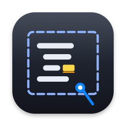
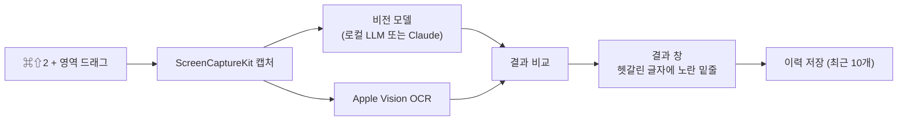

<p align="center">
  
</p>

<h1 align="center">iCapture</h1>

<p align="center">
  화면에 보이지만 복사할 수 없는 텍스트를 캡처해서, AI 비전 모델로 <b>한 글자도 틀리지 않게</b> 옮겨 주는 macOS 메뉴 막대 앱
</p>

<p align="center">
  
  
  
  
</p>

<p align="center"><a href="README.md">English</a> · 한국어</p>

---

## 왜 만들었나

원격 데스크톱, 이미지로 된 문서, 영상 속 코드처럼 드래그로 복사가 안 되는 텍스트가 있어요. 보통은 OCR(광학 문자 인식) 프로그램으로 옮기는데, SQL이나 로그를 옮기면 꼭 몇 글자씩 틀립니다. 예를 들면 이런 식이에요.

```sql
-- 화면에 보이는 그대로
WHERE u.level = 1 AND m.grp_cd IN ('O0', 'l1')

-- OCR이 흔히 틀리는 모습
WHERE u.1evel = 1 AND m.grp_cd IN ('00', '11')
```

`select`의 `l`이 `1`로, `O`가 `0`으로 바뀌어도 눈으로는 잘 안 보여요. 그런데 붙여 넣고 실행하면 바로 에러가 나죠. 결국 원본과 한 글자씩 대조하게 됩니다.

iCapture는 글자 모양만 보는 OCR 대신 **문맥을 이해하는 비전 모델**에게 이미지를 읽힙니다. 여기에 macOS 내장 OCR(Apple Vision)로 한 번 더 읽어서, 두 결과가 서로 다르게 읽은 헷갈리는 글자에는 **노란 밑줄**을 그어 줘요. 밑줄 친 곳만 확인하면 됩니다.

## 주요 기능

- **단축키 한 번으로 캡처**: 어떤 앱을 보고 있든 `⌘⇧2`를 누르고 영역을 드래그하면 끝이에요. 단축키는 설정에서 바꿀 수 있어요.
- **스트리밍 결과 창**: 왼쪽에는 캡처 이미지, 오른쪽에는 인식된 텍스트가 나와요. 글자는 받는 대로 바로 채워지고, 상태 줄에서 단계와 경과 시간을 보여 줍니다.
- **헷갈린 글자 표시**: `l`/`1`/`I`, `O`/`0`처럼 혼동하기 쉬운 글자 가운데 두 엔진이 다르게 읽은 곳에 노란 밑줄을 그어요. 고치면 밑줄이 사라지고 "확인 필요 N곳" 숫자도 함께 줄어요.
- **편집과 복사**: 결과는 바로 고칠 수 있어요. `⌘Z`/`⌘⇧Z`로 되돌리기와 다시 실행이 되고, "다시 인식" 결과도 한 번에 되돌릴 수 있어요. `⌘C`나 "전체 복사"는 서식 없는 텍스트로만 복사해서 IDE에 붙여도 색이나 글꼴이 딸려 가지 않아요.
- **종류 자동 판별**: SQL, 에러 로그, 표, 엑셀 화면을 모델이 알아서 구분해요. 표와 엑셀은 Markdown 표로 바꿔 주고, 엑셀의 열 머리글(A, B, C…)과 행 번호(1, 2, 3…)는 빼고 셀 데이터만 남겨요.
- **엔진 선택**: 기본은 **비용이 들지 않는 로컬 LLM**(Nativ, Ollama, vLLM, LM Studio 등)이에요. 원하면 Claude(Sonnet 5.5, Haiku 5.5)로 바꿀 수 있어요.
- **최근 10개 이력**: 메뉴 막대에서 최근 5개를 바로 열 수 있고, 이력 창(`⌘Y`)에서는 10개 전체를 검색할 수 있어요.
- **메뉴 막대에만 상주**: Dock 아이콘 없이 메뉴 막대에만 떠 있어요. 인식 중에는 아이콘이 깜빡이고, 다른 앱을 보는 사이에 끝나면 초록 점으로 알려 줍니다.

## 동작 방식



1. 고른 영역을 Retina 해상도 그대로 캡처해요.
2. 비전 모델에게 "보이는 그대로, 고치지 말고, 설명 없이 옮겨라"라는 지시와 함께 이미지를 보내요. 들여쓰기와 줄바꿈도 그대로 유지하라고 지시합니다.
3. 같은 이미지를 Apple Vision으로도 읽어서 두 결과를 글자 단위로 비교해요. 혼동하기 쉬운 글자가 얽힌 불일치에만 표시를 붙여요.

## 요구 사항

| 항목 | 내용 |
|---|---|
| macOS | 26 이상, Apple Silicon |
| 빌드 도구 | Xcode 27 이상, [XcodeGen](https://github.com/yonaskolb/XcodeGen) (`brew install xcodegen`) |
| 인식 엔진 | 둘 중 하나 이상 |
| · 로컬 LLM (기본) | OpenAI 호환 API를 여는 로컬 서버와 **이미지를 읽을 수 있는 모델**(예: Qwen3-VL, Qwen2.5-VL, Llama 3.2 Vision, LLaVA) |
| · Claude (선택) | Anthropic API 키. 사용량만큼 비용이 들어요. Claude Pro 같은 구독에는 API 사용량이 포함되지 않아요. |

## 설치와 실행

```bash
git clone https://github.com/lizen/icapture.git ~/github/icapture
cd ~/github/icapture
```

**1. 서명 팀 바꾸기**

`Configuration/Signing.xcconfig`의 `DEVELOPMENT_TEAM`을 자신의 Apple 개발 팀 ID로 바꿔요. 팀 ID는 Xcode → Settings → Accounts에서 볼 수 있어요.

```
DEVELOPMENT_TEAM = <내 팀 ID>
```

매번 같은 인증서로 서명해야 다시 빌드할 때마다 화면 기록 권한을 또 묻지 않아요.

**2. 빌드하고 실행하기**

```bash
make xcode-run
```

`project.yml`로 Xcode 프로젝트를 만들고(`xcodegen`), 빌드한 뒤 `iCapture.app`을 실행해요. 실행하면 메뉴 막대에 아이콘이 나타나요.

> 앱이 이미 켜져 있으면 `open`은 새 빌드를 띄우지 않고 켜져 있던 앱을 앞으로 가져오기만 해요. 코드를 고친 뒤에는 `pkill -x iCapture; make xcode-run`으로 실행해 주세요.

**3. 화면 기록 권한 허용하기**

처음 `⌘⇧2`를 누르면 macOS가 화면 기록 권한을 물어요. 시스템 설정에서 iCapture를 허용한 뒤, 메뉴 막대 아이콘의 "종료"로 끄고 다시 실행해 주세요.

## 로컬 LLM 연결

설정 창(`⌘,`)의 "로컬 LLM 서버 주소"에 서버 주소를 넣어요. 주소 뒤에 `/v1/chat/completions`와 `/v1/models`가 붙는 OpenAI 호환 서버면 어디든 돼요.

| 서버 | 기본 주소 |
|---|---|
| [Nativ](https://github.com/Blaizzy/nativ) | `http://127.0.0.1:8080` (iCapture 기본값) |
| [Ollama](https://ollama.com) | `http://localhost:11434` |
| [LM Studio](https://lmstudio.ai) | `http://localhost:1234` |
| [vLLM](https://docs.vllm.ai) | `http://127.0.0.1:8000` |

- 엔진을 **"로컬 모델 (자동)"** 으로 두면, 서버의 모델 목록에서 메모리에 올라간 모델을 먼저 보고, 그중 이름으로 보아 비전 모델인 것(`vl`, `vision`, `llava` 등)을 골라요. 임베딩 모델은 제외해요.
- 특정 모델을 쓰고 싶으면 결과 창이나 설정의 엔진 목록에서 `로컬: <모델 이름>`을 고르면 돼요.
- 서버에 API 키가 걸려 있다면 "로컬 LLM API 키"에 넣어 주세요. 키는 macOS 키체인에 저장돼요.
- 앱을 켜고 처음 인식할 때는 모델을 깨우느라 30~70초쯤 걸릴 수 있어요.

## 사용법

| 동작 | 방법 |
|---|---|
| 영역 캡처 | `⌘⇧2` → 드래그. `esc`를 누르거나 클릭만 하면 취소 |
| 인식 중 멈추기 | 결과 창에서 `esc` 또는 "취소". 받은 텍스트는 남아요 |
| 전체 복사 | "전체 복사" 버튼, 또는 `⌘A` → `⌘C` |
| 일부 복사 | 드래그로 고른 뒤 `⌘C` |
| 되돌리기 / 다시 실행 | `⌘Z` / `⌘⇧Z` |
| 다른 엔진으로 다시 인식 | 결과 창 엔진 목록에서 고르고 "다시 인식" |
| 이력 보기 | 메뉴 막대 아이콘 → 최근 캡처, 또는 `⌘Y` |
| 설정 | 메뉴 막대 아이콘 → 설정…, 또는 `⌘,` |

## 정확도 측정

정답이 있는 검증용 그림 9장으로 엔진의 정확도와 속도를 잴 수 있어요. 한글 주석이 섞인 SQL, 에러 로그, 표, 엑셀 화면, 작은 글씨와 어두운 테마가 들어 있어요.

```bash
ICAPTURE_ACCURACY=1 make accuracy
```

- 기본으로 로컬 LLM만 재서 비용이 들지 않아요. 결과는 `build/accuracy-report.md`에 저장돼요.
- `LOCAL_BASE_URL`, `LOCAL_MODEL`, `LOCAL_API_KEY`로 서버와 모델을 바꿀 수 있어요.
- `ANTHROPIC_API_KEY`를 함께 주면 Claude Sonnet과 Haiku도 재요(요청 18회, API 비용 발생).

`Qwen3-VL-30B-A3B-Instruct-4bit`(Nativ)로 잰 최근 결과는 이래요.

| 항목 | 결과 |
|---|---|
| 평균 글자 일치율 | 97.4% |
| 완전 일치 | 2/9 (표, 엑셀) |
| 장당 평균 시간 | 약 10초 (첫 장은 모델을 깨우느라 더 걸림) |

아직 SQL과 로그에서는 줄 앞 들여쓰기가 빠지거나 `O`/`0`을 섞어 읽는 실수가 1~3자씩 남아요. 지금 목표(SQL·로그에서 노란 표시 없이 틀린 글자 0개)에는 못 미쳐서 계속 개선하고 있어요.

## 개발

```bash
make test                                   # 단위 테스트 (138개)
make test ONLY=iCaptureTests/ClaudeEngineTests  # 테스트 하나만
make xcode-build                            # 빌드만
make clean                                  # build/ 삭제
swift scripts/render-app-icon.swift         # Design/AppIcon.svg로 앱 아이콘 다시 만들기
swift scripts/render-fixtures.swift         # 정확도 검증용 그림 다시 만들기
```

```
Sources/iCapture/
  App/    메뉴 막대, 단축키, 영역 선택, 캡처, 결과·이력·설정 창
  Core/   테스트 대상 로직
    Recognition/  지시문, 종류 태그 파서, Claude·로컬 LLM 엔진, Vision OCR
    Marks/        헷갈린 글자 표시, 텍스트 비교
    Session/      인식 세션(단계, 경과 시간, 취소)
    History/      최근 10개 이력 저장소
    Settings/     설정, 단축키 조합, 키체인
    Text/         결과 텍스트 영역(복사, 되돌리기, 표시)
Tests/
  iCaptureTests/          단위 테스트
  iCaptureAccuracyTests/  정확도 측정
  AccuracyFixtures/       검증용 그림과 정답
docs/superpowers/         설계 문서와 구현 계획
```

## 데이터와 개인 정보

- **캡처 이미지가 가는 곳**: 로컬 LLM을 쓰면 설정한 서버로만 가요. 기본 주소는 이 맥 안(`127.0.0.1`)이에요. Claude를 쓰면 Anthropic API로 전송돼요.
- **이력**: 최근 10개의 캡처 이미지와 텍스트를 `~/github/icapture/hist/`에 저장해요. 이 폴더는 git에 올라가지 않아요. 지울 때는 이력 창의 "이력 비우기"를 쓰면 돼요.
- **API 키**: Claude 키와 로컬 LLM 키는 macOS 키체인에만 저장해요.

## 알려진 한계

- 이력 저장 위치가 `~/github/icapture/hist/`로 고정돼 있어요. 다른 위치에 클론해도 이력은 이 경로에 저장돼요.
- 로컬 모델은 들여쓰기와 헷갈리는 글자에서 아직 실수가 남아 있어요(위 정확도 측정 참고).
- 개인용으로 직접 빌드해서 쓰는 앱이에요. App Store 배포나 샌드박스는 지원하지 않아요.
- 영역 캡처만 지원해요. 전체 화면이나 창 단위 캡처, 동영상 녹화는 하지 않아요.

## 라이선스

[MIT](LICENSE)
