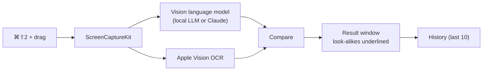

<p align="center">
  
</p>

<h1 align="center">iCapture</h1>

<p align="center">
  <b><i>Capture the text on your screen, not just its pixels — transcribed by a vision model, character for character.</i></b>
</p>

<p align="center">
  
  
  
  
  
</p>

<p align="center">
  <a href="#what-icapture-can-do">Features</a> ·
  <a href="#get-started">Get started</a> ·
  <a href="#connect-a-local-llm">Local LLMs</a> ·
  <a href="#usage">Usage</a> ·
  <a href="#measuring-accuracy">Accuracy</a> ·
  <a href="#development">Development</a> ·
  <a href="README.ko.md">한국어</a>
</p>

---

## Why iCapture

Some text can't be selected: a remote desktop session, a scanned document, code in a video. OCR tools get you most of the way, but code and logs are unforgiving. A typical mistake looks like this:

```sql
-- What's on screen
WHERE u.level = 1 AND m.grp_cd IN ('O0', 'l1')

-- What OCR often gives you
WHERE u.1evel = 1 AND m.grp_cd IN ('00', '11')
```

An `l` that became a `1` is easy to miss and breaks the query the moment you run it.

iCapture sends the capture to a **vision language model** that reads in context: it knows `se1ect` isn't a SQL keyword. It also reads the same image with Apple's built-in OCR (Vision) and **underlines in yellow** every look-alike character the two readers disagree on, so you only check the spots that matter.

## What iCapture can do

| Feature | What you get |
|---|---|
| **One-shortcut capture** | Press `⌘⇧2` in any app, drag a region, done. The shortcut is configurable. |
| **Streaming result window** | The capture on the left, editable text on the right. Text streams in as the model writes, with a status line showing the current step and elapsed time. |
| **Look-alike highlighting** | `l`/`1`/`I`, `O`/`0`, `S`/`5` and friends are underlined when the model and Apple Vision disagree. Fix one and its mark disappears, along with the "needs review" count. |
| **Edit and copy** | Edit freely with `⌘Z` / `⌘⇧Z`, including undoing a whole re-recognition. `⌘C` and **Copy All** put plain text on the clipboard, so nothing but characters lands in your IDE. |
| **Content-aware output** | SQL, logs, tables and spreadsheets are detected automatically. Tables become Markdown tables; spreadsheet column letters (A, B, C…) and row numbers (1, 2, 3…) are stripped. |
| **Local LLM first** | Runs on a local OpenAI-compatible server by default — Nativ, Ollama, LM Studio, vLLM — at no cost. Claude Sonnet 5.5 and Haiku 5.5 are available as optional engines. |
| **Recent history** | The last 10 captures are kept. The 5 most recent are one click away in the menu bar; the history window (`⌘Y`) lets you search all 10. |
| **Menu bar only** | No Dock icon. The menu bar icon pulses while recognizing and shows a green dot when a result is ready in the background. |

## How it works



1. The selected region is captured at full Retina resolution.
2. The image goes to the model with strict instructions: transcribe exactly, never fix or explain, keep line breaks and indentation, and tag the content type.
3. Apple Vision reads the same image. The two results are diffed character by character, and only disagreements involving look-alike characters are marked.

## Requirements

- A Mac with Apple silicon running **macOS 26** or later.
- **Xcode 27** and [XcodeGen](https://github.com/yonaskolb/XcodeGen) (`brew install xcodegen`) to build.
- At least one recognition engine:
  - **A local LLM server (default)** with an OpenAI-compatible API and a **vision-capable model** such as Qwen3-VL, Qwen2.5-VL, Llama 3.2 Vision or LLaVA.
  - **Claude (optional)** with an Anthropic API key. API usage is billed separately; subscriptions such as Claude Pro do not include API usage.

## Get started

There are no prebuilt releases yet, so build from source.

```sh
git clone https://github.com/lizen/icapture.git ~/github/icapture
cd ~/github/icapture
```

**1. Set your signing team.** Open `Configuration/Signing.xcconfig` and replace the team ID with your own (Xcode → Settings → Accounts):

```
DEVELOPMENT_TEAM = <YOUR_TEAM_ID>
```

Signing every build with the same Apple Development certificate keeps the Screen Recording permission across rebuilds.

**2. Build and run.**

```sh
make xcode-run
```

This generates the Xcode project from `project.yml`, builds `iCapture.app`, and launches it. Look for the icon in the menu bar.

> `open` brings an already running copy to the front instead of launching the new build. After changing code, run `pkill -x iCapture; make xcode-run`.

**3. Grant Screen Recording.** The first `⌘⇧2` asks for permission. Allow iCapture in System Settings, then quit it from the menu bar icon and launch it again.

## Connect a local LLM

Open **Settings** (`⌘,`) and enter your server's base URL under *Local LLM server URL*. Any server that serves `/v1/chat/completions` and `/v1/models` works.

| Server | Default base URL |
|---|---|
| [Nativ](https://github.com/Blaizzy/nativ) | `http://127.0.0.1:8080` (iCapture's default) |
| [Ollama](https://ollama.com) | `http://localhost:11434` |
| [LM Studio](https://lmstudio.ai) | `http://localhost:1234` |
| [vLLM](https://docs.vllm.ai) | `http://127.0.0.1:8000` |

- With the engine set to **Local model (auto)**, iCapture lists the server's models, prefers ones already loaded in memory, and picks one whose name suggests vision support (`vl`, `vision`, `llava`, …). Embedding models are skipped.
- To pin a model, choose `Local: <model id>` from the engine menu in the result window or in Settings.
- If your server requires a key, enter it as the *Local LLM API key*. Keys are stored in the macOS Keychain.
- The first recognition after launch can take 30–70 seconds while the model warms up.

## Usage

| Action | How |
|---|---|
| Capture a region | `⌘⇧2`, then drag. `esc` or a single click cancels. |
| Stop recognition | `esc` or **Cancel** in the result window. Text received so far is kept. |
| Copy everything | **Copy All**, or `⌘A` then `⌘C` |
| Copy part of it | Select with the mouse, then `⌘C` |
| Undo / redo | `⌘Z` / `⌘⇧Z` |
| Try another engine | Pick it in the result window's engine menu and press **Recognize Again** |
| Open history | Menu bar icon → recent captures, or `⌘Y` |
| Settings | Menu bar icon → Settings…, or `⌘,` |

> The app's UI is currently in Korean. Button names above are translated.

## Measuring accuracy

A set of nine rendered screenshots with known ground truth — SQL with Korean comments, Java and Python stack traces, a table, a spreadsheet, small dark-theme text — measures each engine's accuracy and speed.

```sh
ICAPTURE_ACCURACY=1 make accuracy
```

- By default only the local LLM is measured, so it costs nothing. The report is written to `build/accuracy-report.md`.
- Use `LOCAL_BASE_URL`, `LOCAL_MODEL` and `LOCAL_API_KEY` to point at a different server or model.
- Add `ANTHROPIC_API_KEY` to include Claude Sonnet and Haiku (18 requests, billed).

Latest results with `Qwen3-VL-30B-A3B-Instruct-4bit` on Nativ:

| Metric | Result |
|---|---|
| Average character accuracy | 97.4% |
| Exact matches | 2 / 9 (table, spreadsheet) |
| Average time per image | ~10 s (the first image takes longer while the model warms up) |

SQL and log captures still lose leading indentation or mix up `O`/`0` in 1–3 places per image. The goal — zero unmarked errors on SQL and logs — isn't met yet, and work continues.

## Privacy

- **Where captures go.** With a local LLM, only to the server you configured (by default `127.0.0.1`, on your Mac). With Claude, to the Anthropic API.
- **History.** The last 10 captures (image and text) are stored in `~/github/icapture/hist/`, which is git-ignored. Clear them with **Clear History** in the history window.
- **Keys.** The Claude and local LLM API keys live only in the macOS Keychain.

## Project layout

```text
icapture/
├── Sources/iCapture/
│   ├── App/                 # Menu bar, hotkey, region overlay, capture, result/history/settings windows
│   └── Core/                # Testable logic
│       ├── Recognition/     # Prompt, content-type tag parser, Claude and local LLM engines, Vision OCR
│       ├── Marks/           # Look-alike highlighting, text diff
│       ├── Session/         # Recognition session: phases, elapsed time, cancel
│       ├── History/         # Last-10 history store
│       ├── Settings/        # Settings, hotkey combo, Keychain
│       └── Text/            # Result text view: copy, undo, marks
├── Tests/
│   ├── iCaptureTests/           # Unit tests
│   ├── iCaptureAccuracyTests/   # Accuracy harness
│   └── AccuracyFixtures/        # Screenshots and ground truth
├── Design/AppIcon.svg       # App icon source
├── scripts/                 # Icon and fixture renderers
├── docs/superpowers/        # Design spec and implementation plan (Korean)
└── project.yml              # XcodeGen project definition
```

## Development

```sh
make test                                       # Unit tests (138)
make test ONLY=iCaptureTests/ClaudeEngineTests  # A single test class
make xcode-build                                # Build only
make clean                                      # Remove build/
swift scripts/render-app-icon.swift             # Regenerate the app icon from Design/AppIcon.svg
swift scripts/render-fixtures.swift             # Regenerate the accuracy screenshots
```

## Known limitations

- The history folder is fixed at `~/github/icapture/hist/`, regardless of where you clone the repository.
- Local models still drop indentation and confuse look-alike characters now and then (see [Measuring accuracy](#measuring-accuracy)).
- Built for personal use: no App Store distribution and no sandbox.
- Region capture only — no full-screen or window capture, and no video recording.
- The UI is in Korean.

## Credits

iCapture stands on these:

- [ScreenCaptureKit](https://developer.apple.com/documentation/screencapturekit) and the [Vision](https://developer.apple.com/documentation/vision) framework from Apple
- [XcodeGen](https://github.com/yonaskolb/XcodeGen) for the project file
- [Nativ](https://github.com/Blaizzy/nativ) and [mlx-vlm](https://github.com/Blaizzy/mlx-vlm) for running vision models locally on Apple silicon
- [Claude](https://www.anthropic.com/claude) by Anthropic as an optional cloud engine

## Similar open source tools

- [NormCap](https://github.com/dynobo/normcap) — OCR-powered screen capture (Linux, macOS, Windows)
- [TRex](https://github.com/amebalabs/TRex) — text extraction from the screen (macOS)
- [Text Grab](https://github.com/TheJoeFin/Text-Grab) — OCR utility (Windows)

## License

[MIT](LICENSE)
